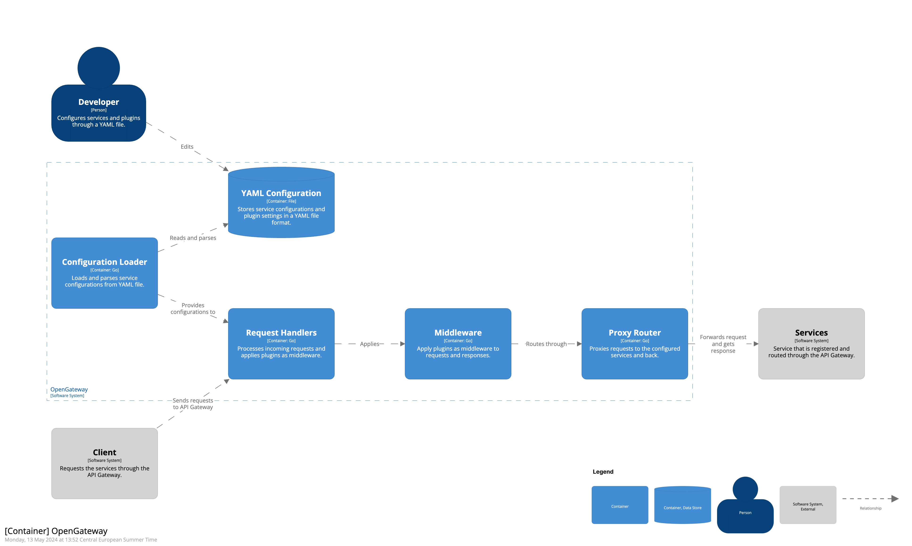
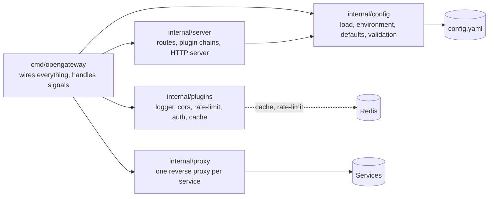
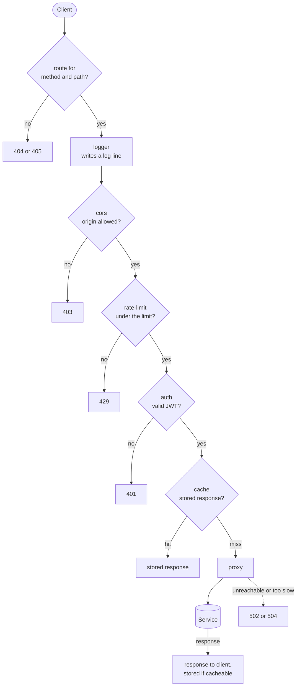

# Architecture

OpenGateway is a single Go binary. It reads one YAML file, builds a route for every configured endpoint, and reverse-proxies matching requests to the service behind it. Redis is only needed by the `cache` and `rate-limit` plugins.

The first two diagrams follow the [C4 model](https://c4model.com/); their sources are in [diagrams-as-code](diagrams-as-code).

## Context

Who uses the gateway and what it talks to.

## Containers

The main parts inside the gateway.

## Packages

How the code is organised. Arrows point from a package to what it uses.

- **`cmd/opengateway`** loads the config, builds only the plugins that some endpoint uses, and starts the server.
- **`internal/config`** owns the config file format. Nothing else reads files or environment variables.
- **`internal/server`** registers one route per endpoint and wraps it in that endpoint's plugins.
- **`internal/plugins/<name>`** holds one plugin each: its logic and its HTTP middleware.
- **`internal/proxy`** forwards a request to a service and maps failures to `502` and `504`.

## Request flow

A request to an endpoint that uses every plugin. Each plugin can answer on its own and end the request early.

Plugins always run in this order: `logger`, `cors`, `rate-limit`, `auth`, `cache`. Auth runs before the cache so a stored response is never served to a caller that has not been authenticated.
