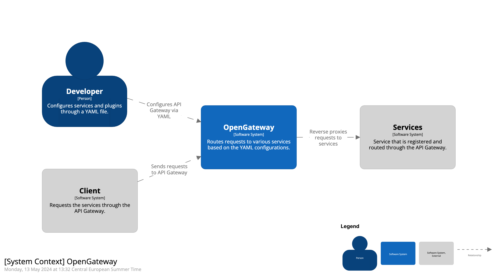
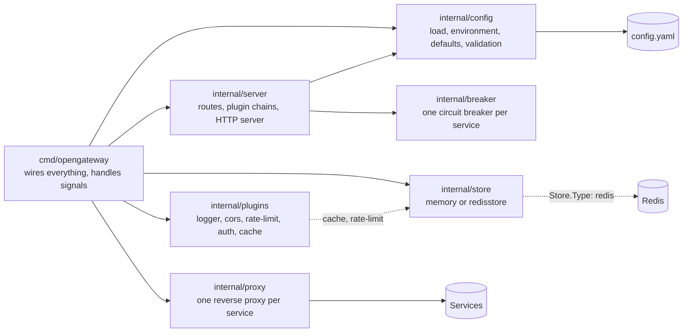
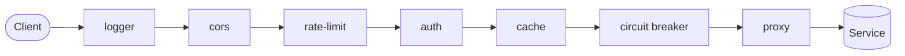

# Architecture

OpenGateway is a single Go binary. It reads one YAML file, builds a route for every configured endpoint, and reverse-proxies matching requests to the service behind it. Nothing else is required: the `cache` and `rate-limit` plugins keep their state in memory unless the config points them at Redis.

The first two diagrams follow the [C4 model](https://c4model.com/); their sources are in [diagrams-as-code](diagrams-as-code).

## Context

Who uses the gateway and what it talks to.

## Containers

The main parts inside the gateway.

## Packages

How the code is organised. Arrows point from a package to what it uses.

- **`cmd/opengateway`** loads the config, builds only the plugins that some endpoint uses, and starts the server.
- **`internal/config`** owns the config file format. Nothing else reads files or environment variables.
- **`internal/server`** registers one route per endpoint and wraps it in that endpoint's plugins and its service's circuit breaker.
- **`internal/breaker`** answers `503` for a service that keeps failing, without calling it, until it has had time to recover.
- **`internal/plugins/<name>`** holds one plugin each: its logic and its HTTP middleware.
- **`internal/store`** defines the `Store` interface the cache and rate-limit plugins use, with a `memory` and a `redisstore` backend. A new backend implements `Get`, `Set` and `Increment` and passes `storetest.Run`.
- **`internal/proxy`** forwards a request to a service and maps failures to `502` and `504`.

## Request flow

A request to an endpoint that uses every plugin. Plugins always run in this order, whatever order the config lists them in.

Each step can answer on its own and end the request early:

| Step         | Ends the request when                              | Response                    |
| ------------ | -------------------------------------------------- | --------------------------- |
| router       | no endpoint matches the path or the method         | `404` or `405`              |
| `logger`     | never; it only writes a log line                   |                             |
| `cors`       | the `Origin` is not allowed                        | `403`                       |
| `rate-limit` | the client IP is over its limit                    | `429`                       |
| `auth`       | the JWT is missing or invalid                      | `401`                       |
| `cache`      | a stored response exists                           | the stored response         |
| breaker      | the service failed too often in a row              | `503` with `Retry-After`    |
| proxy        | the service is unreachable, or too slow to answer  | `502`, or `504`             |

Auth runs before the cache so a stored response is never served to a caller that has not been authenticated.
